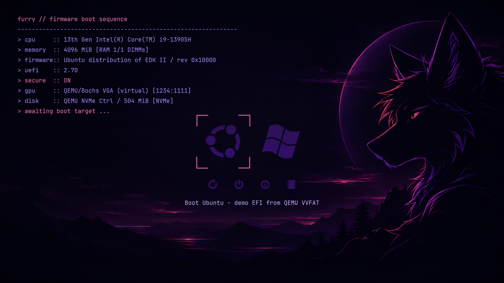
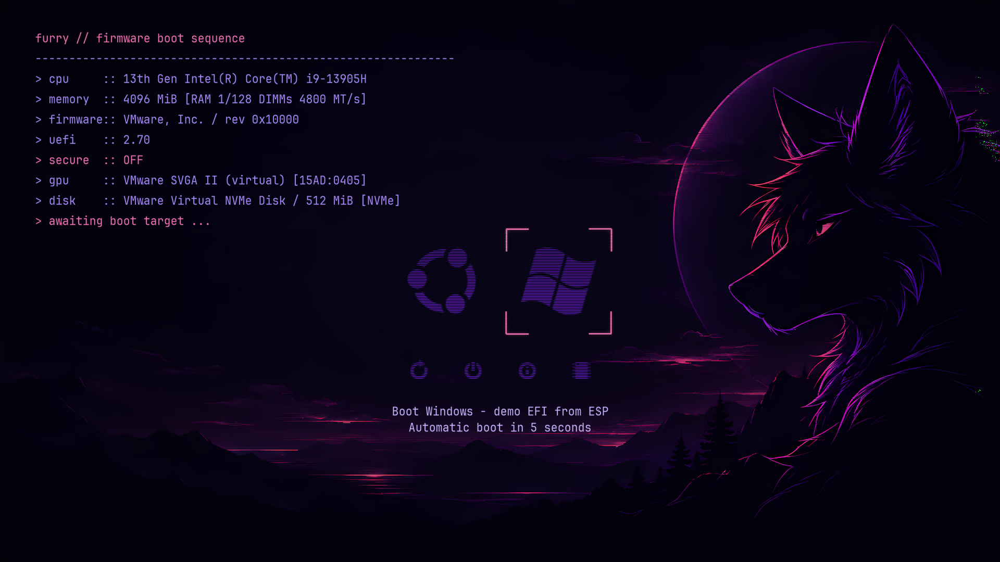
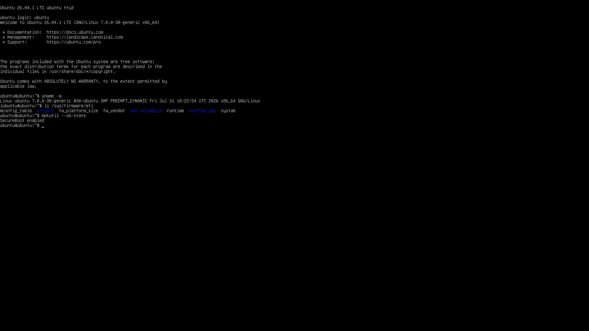
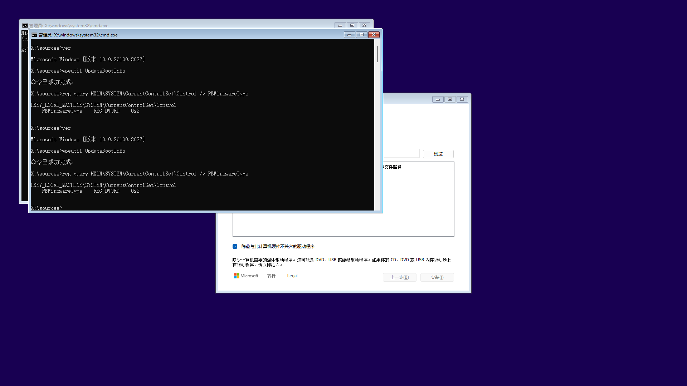

<div align="center">

# 🐺 rEFInd Furry Dynamic


**A customized rEFInd boot manager with live UEFI hardware information, a purple terminal interface, and a 3840 × 2160 furry background.**

[📦 Ubuntu Installation](#-ubuntu-installation) · [🧪 Validation](#-validation-status) · [🛠️ Development](#-build-and-simulation) · [📋 Roadmap](furry-project/TODO.md)

</div>

---

## 💡 Overview

**rEFInd Furry Dynamic** reads hardware and firmware information while the EFI boot menu is being rendered. CPU, memory, firmware, Secure Boot, GPU, and disk text are drawn by the boot manager over an independent background image.

The theme adapts the **finn-term** purple/pink terminal style to a furry wolf background. Fonts, icons, and the information panel scale with the actual firmware graphics mode. The background is 4K; tested menu resolutions include 720p, 1080p, and 4K.

**Windows is selected by default and boots after a visible 5-second countdown.** Press any key to cancel the countdown and choose another entry. The production configuration scans real OS loaders, including other EFI System Partitions. If no Windows entry is found, selection falls back to the first bootable entry.

This repository preserves the official [rEFInd SourceForge](https://sourceforge.net/projects/refind/) Git history. It is an independent derivative hosted on GitHub, with SourceForge retained as `upstream`. Original upstream documentation remains in [README.txt](https://github.com/RockyMtnWolf/refind-furry-dynamic/blob/furry-dynamic/README.txt) and [BUILDING.txt](https://github.com/RockyMtnWolf/refind-furry-dynamic/blob/furry-dynamic/BUILDING.txt).

## 📷 Actual VM Screenshots

These are captures of running virtual machines. Hardware values describe the VM; synthetic SMBIOS fixtures are identified in the validation records.

<table>
  <tr>
    <td align="center"><a href="furry-project/evidence/phase2/final-4k.png"></a><br><b>QEMU / OVMF · 4K · Secure Boot ON</b></td>
    <td align="center"><a href="furry-project/evidence/phase2/vmware-windows-countdown-5s.png"></a><br><b>VMware · 1080p · Windows countdown</b></td>
  </tr>
  <tr>
    <td align="center"><a href="furry-project/evidence/phase2/ubuntu-uefi-proof.png"></a><br><b>Ubuntu Live · UEFI / Secure Boot proof</b></td>
    <td align="center"><a href="furry-project/evidence/phase2/windows-uefi-proof.png"></a><br><b>Windows WinPE · UEFI proof</b></td>
  </tr>
</table>

The VMware countdown screenshot uses an explicitly labeled demo EFI entry. Its timeout test confirms selection and automatic launch. The separate QEMU Windows test uses Microsoft's actual EFI boot manager and reaches WinPE.

## ✨ Key Features

- **Live information at boot:** firmware data is collected inside rEFInd; hardware text is not baked into the background or generated by an OS script for the next reboot.
- **4K furry theme:** independent 3840 × 2160 PNG, terminal font, purple icons, and pink selection brackets.
- **Adaptive layout:** 720p / 1080p / 4K scaling, bounded text width, truncation for long names, and correct font caches after rescanning.
- **Windows by default:** native five-second countdown, Windows/Microsoft title matching, keyboard cancellation, and manual Ubuntu selection.
- **Ubuntu installer:** builds the custom EFI binary, installs the theme in a dedicated ESP directory, backs up prior project files and BootOrder, and supports Ubuntu shim + MOK signing.
- **Repeatable VM lab:** QEMU + OVMF, isolated Secure Boot variables, real Ubuntu/Windows installation media, VMware NVMe test disk generation, and screenshots without guest tools.

## 📊 Information Providers

| Field | UEFI source | Fallback / behavior |
| :--- | :--- | :--- |
| CPU | x86 CPUID brand string | SMBIOS Type 4 Processor Version; otherwise unavailable |
| Memory | SMBIOS 2/3 Type 17 | EFI memory map, explicitly labeled `EFI mapped RAM` |
| Memory details | Type 17 capacity, type, slots, configured speed | Extended/KiB capacities supported; lowest configured speed across populated DIMMs |
| Firmware | EFI System Table | Vendor and firmware revision |
| UEFI version | System Table header revision | Actual firmware interface version |
| Secure Boot | EFI global `SecureBoot` variable | `ON`, `OFF`, or `UNKNOWN`; read failure is not treated as OFF |
| GPU | PCI Display Controller + GOP preference | Exact PCI vendor/device ID; optional name mapping; virtual adapters labeled |
| Disk | Block I/O + Device Path | Disk Info or read-only NVMe Identify for model; Block I/O capacity; explicit unavailable model |

Disk selection prefers the current boot disk. Transport is identified where supported as NVMe, SATA, USB, or SCSI. Disk GB is decimal; MiB is binary. EFI mapped RAM excludes reserved, unusable, and MMIO regions and is not presented as installed DIMM capacity.

Set `dynamic_info true` in the theme configuration to enable the overlay. Set it to `false` to use the ordinary theme behavior. GPU labels use exact `vvvv:dddd|Name` entries in [gpu-names.txt](furry-project/theme/gpu-names.txt).

## 🧪 Validation Status

**VM validation has passed for the scenarios below. Physical-machine validation remains TODO.** Tests were recorded on October 6–7, 2026.

| Test | Status | Evidence / scope |
| :--- | :---: | :--- |
| Clean x86_64 GNU-EFI build | ✅ Passed | GCC 13.2 / GNU-EFI 3.0.15, WSL Ubuntu 24.04 |
| QEMU / OVMF menu and dynamic information | ✅ Passed | QEMU 8.2.2 / OVMF 2024.02; 720p, 1080p, 4K |
| CPUID, SMBIOS, EFI memory-map fallback | ✅ Passed | VM provider variations and explicitly synthetic SMBIOS fixtures |
| SMBIOS parser regressions | ✅ Passed | ASan / UBSan; malformed/truncated records, extended/unknown capacities, CPU fallback |
| Secure Boot signed chain | ✅ Passed | Isolated OVMF keys; signed child launches, unsigned child rejected |
| Ubuntu actual boot | ✅ Passed | Live user-space login, EFI runtime available, `SecureBoot enabled` |
| Windows actual EFI boot | ✅ Passed | Microsoft boot manager → WinPE; `PEFirmwareType = 2` |
| VMware menu, GPU, NVMe | ✅ Passed | Workstation 25, virtual hardware 21; 1080p, Secure Boot OFF |
| Windows default + five-second timeout | ✅ Passed | VMware captures of selected Windows demo entry, countdown, automatic launch |
| Ubuntu installer package regression | ✅ Passed | Repeated staging, exact files/configuration, invalid EFI rejection |
| Physical hardware / real Ubuntu installation | ⏳ TODO | Firmware compatibility, MOK enrollment, recovery and real OS boot |
| Second physical Windows system disk | ⏳ TODO | Discovery and full Windows boot with Secure Boot enabled |
| VMware Ubuntu MOK / full dual-disk OS boot | ⏳ TODO | Separate from the completed VMware menu test |
| Hyper-V | ⏳ TODO | Test session lacked VM-management permission |

WinPE validation does not imply a completed Windows installation or Windows desktop test. The lab enrolls its own certificate only into isolated OVMF variables; those keys are not production keys.

Detailed records: [Phase 1](furry-project/evidence/VERIFICATION.md), [Phase 2](furry-project/evidence/phase2/VERIFICATION.md), [Physical-machine checklist](furry-project/HARDWARE-TEST.md). The existing detailed lab records are in Chinese; this README provides the English status and reproduction entry points.

## 📦 Ubuntu Installation

For **x86_64 Ubuntu booted in UEFI mode**, with a mounted GPT/FAT32 EFI System Partition:

```bash
git clone https://github.com/RockyMtnWolf/refind-furry-dynamic.git
cd refind-furry-dynamic
sudo bash furry-project/scripts/install-ubuntu.sh
```

The installer installs dependencies, builds this custom rEFInd, and installs into `EFI/refind-furry/`. It scans real Windows/Ubuntu EFI loaders and sets the new firmware entry first in BootOrder. It does not format the ESP, replace `EFI/BOOT`, install demo entries, or install extra filesystem EFI drivers. Ubuntu boots through its existing shim/GRUB chain.

Production menu defaults:

```conf
timeout 5
default_selection "Windows,Microsoft"
scanfor internal,external,optical,manual
```

### Secure Boot

With Secure Boot disabled, one run completes installation. With Secure Boot enabled:

1. The first run creates a machine-specific signing key and requests MOK enrollment. Set the requested temporary password. The installer exits with code `2` before activating a new boot entry.
2. Reboot through the existing Ubuntu shim. In MokManager, select **Enroll MOK → Continue → Yes**, enter the password, and reboot.
3. Run the same installer again. It signs the custom rEFInd and installs the Ubuntu shim/MokManager chain.

The key is stored under `/var/lib/refind-furry/keys/`; preserve it for updates and keep it private. Firmware enrollment requires your confirmation. VM signing keys are not included in the repository. This installation/MOK workflow still needs physical-machine validation.

### Options and Recovery

| Option | Purpose |
| :--- | :--- |
| `--esp /mount/point` | Select a mounted ESP; defaults checked are `/boot/efi`, `/efi`, `/boot` |
| `--no-activate` | Install/register the entry while retaining the existing BootOrder |
| `--binary /path/custom.efi` | Use an existing custom EFI binary instead of rebuilding |
| `--no-deps` | Skip dependency installation |
| `--stage /tmp/refind-package` | Generate an unsigned installation payload without accessing system ESP/NVRAM |

Prior project installations and BootOrder records are backed up under `/var/lib/refind-furry/backups/`. The installer prints a command to restore the previous BootOrder. The original Ubuntu/Windows entry remains available through the firmware boot menu. The script does not reboot automatically.

## 🛠️ Build and Simulation

### Windows + WSL

Install WSL with an Ubuntu distribution first. The wrappers default to `Ubuntu-24.04`; use `-Distribution` to select another installed distribution.

From the cloned repository:

```powershell
.\furry-project\scripts\setup.ps1
.\furry-project\scripts\build.ps1
.\furry-project\scripts\run.ps1 -Window
```

`setup.ps1` installs GNU-EFI, GCC, QEMU, OVMF, and lab tooling in WSL. `build.ps1` performs a clean build and creates `furry-project/test-esp/`. The basic ESP contains Ubuntu/Windows **demo** entries, both pointing to a small EFI demonstration program.

Use a second terminal for QMP control:

```powershell
.\furry-project\scripts\capture.ps1 -Output qemu-4k.png
.\furry-project\scripts\capture.ps1 -Key ret
.\furry-project\scripts\capture.ps1 -Quit
```

Basic QMP: `127.0.0.1:4444`; VNC: `127.0.0.1:5909`. For a static menu capture, temporarily set `timeout 0` in `furry-project/refind.conf` and rebuild. With the default five-second countdown, the demo launches automatically after the menu appears.

### Secure Boot Lab

Quit any running lab before preparing/resetting its variables:

```powershell
.\furry-project\scripts\lab.ps1 -Action prepare
.\furry-project\scripts\lab.ps1 -Action test
.\furry-project\scripts\lab.ps1 -Action fixtures
.\furry-project\scripts\lab.ps1 -Action on
# In another terminal:
.\furry-project\scripts\lab.ps1 -Action capture -Output phase2/latest.png
.\furry-project\scripts\lab.ps1 -Action quit
```

Lab QMP: `127.0.0.1:4450`; VNC: `127.0.0.1:5910`. KVM uses one virtual CPU by default; `-Accelerator tcg` is available when nested acceleration is unavailable. Large images and frequent serial writes use WSL-local storage to reduce Windows-mount I/O overhead.

For native Ubuntu development, install the dependencies listed in [setup.ps1](furry-project/scripts/setup.ps1), then run `bash furry-project/scripts/build.sh` and `bash furry-project/scripts/run.sh`. Parser and installer package tests are `test.sh` and `test-install-ubuntu.sh` in the same directory.

### Actual OS Media

Use your own Ubuntu/Windows ISO files. In WSL, set `UBUNTU_ISO` or `WINDOWS_ISO` to their Linux paths before running the corresponding preparation script as root:

- Ubuntu: `prepare-ubuntu-lab.sh`, then `lab.ps1 -Action ubuntu -IsoPath <Windows-path-to-ISO> -Width 1920 -Height 1080 -MemoryMiB 6144`.
- Windows: `prepare-windows-media.sh`, then `attach-windows-refind.sh`, then `lab.ps1 -Action windows -Width 1920 -Height 1080 -MemoryMiB 6144`.

Preparation creates isolated GPT/FAT32 images. The Windows helper splits large `install.wim` files into FAT32-compatible SWM files. ISO defaults in the lab scripts reflect the original test workstation; override them on another machine. The signing database used by the lab includes Microsoft 2011 certificates and is a test fixture, not a universal production trust policy.

### VMware

After building, shut down the dedicated test VM and run `prepare-vmware.sh` in WSL. Open the generated `furry-project/vm-tests/vmware/refind-test.vmx` in VMware Workstation.

The template includes the PCIe root ports needed by its NVMe adapter. The tested VMware firmware exposes 1080p rather than 4K, so its ESP requests 1920 × 1080 while retaining the 4K background. `capture-vmware.py` captures the dedicated VM's localhost VNC framebuffer on port `5911` using Python/Pillow; no guest OS or VMware Tools is required.

## 📂 Repository Layout

```text
refind/                       Boot-manager source, including dynamic_info.c / dynamic_devices.c
libeg/                        Graphics, fonts, and adaptive drawing
include/                      EFI protocol definitions
furry-project/
  theme/                      Production 4K background, font atlas, icons, GPU name map
  theme-reference/            Original finn-term resources and licenses
  assets/                     Background source image
  scripts/                    Build, installer, VM setup, capture, regression tests
  evidence/                   Actual VM captures and validation records
  refind.conf                 Demo menu with Windows default and five-second timeout
  TODO.md                     Completed work and remaining validation
  HARDWARE-TEST.md             Physical-machine validation checklist
README.txt, BUILDING.txt       Preserved upstream documentation
```

Generated ESPs, VM disks, firmware variables, and private signing keys are excluded from the project Git files. The included background source was supplied for this project and resized from 6688 × 3764 to 3840 × 2160; no native-generation-resolution claim is made.

## 📋 Roadmap

- [x] Live CPU, memory, firmware, UEFI, and Secure Boot panel.
- [x] GPU PCI/GOP identification and disk model/capacity/transport providers.
- [x] Adaptive 720p / 1080p / 4K theme and rescan behavior.
- [x] QEMU / OVMF Secure Boot, actual Ubuntu Live / Windows WinPE boot, and parser regression tests.
- [x] VMware menu/NVMe validation and Windows five-second countdown.
- [x] Ubuntu installer and repeatable installation-package tests.
- [ ] Physical firmware, GPU/NVMe, SMBIOS, and display-mode compatibility.
- [ ] Real Ubuntu installation, MOK enrollment, updates, and recovery.
- [ ] Second Windows system disk discovery and full Secure Boot launch.
- [ ] VMware MOK / full dual-system-disk boot and Hyper-V validation.

See [TODO.md](furry-project/TODO.md) for the complete checklist and [CHANGES.md](furry-project/CHANGES.md) for implementation notes.

## 📜 Credits and Licenses

- **rEFInd:** based on Rod Smith's upstream; GPL-3.0-or-later code and retained component-specific licenses. See [COPYING.txt](https://github.com/RockyMtnWolf/refind-furry-dynamic/blob/furry-dynamic/COPYING.txt), [LICENSE.txt](https://github.com/RockyMtnWolf/refind-furry-dynamic/blob/furry-dynamic/LICENSE.txt), and [CREDITS.txt](https://github.com/RockyMtnWolf/refind-furry-dynamic/blob/furry-dynamic/CREDITS.txt).
- **finn-term:** FaeArtz; [MIT license](furry-project/theme/LICENSE).
- **Fallout icons:** retained [MIT license](furry-project/theme/LICENSE-fallout-icons).
- **EFI protocol definitions:** original EDK II notices and BSD-2-Clause-Patent terms remain in the relevant headers.
- **Background:** project-supplied furry artwork; original source and production PNG are included.

The official source remote is `https://git.code.sf.net/p/refind/code`; the imported baseline is `cf542da4459ff18535b0ae3a7910af032834e469`. Development uses the `furry-dynamic` branch.
