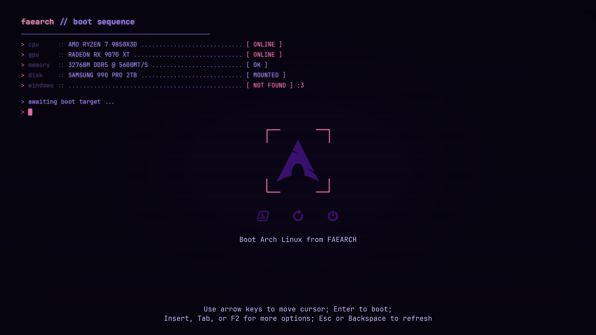

# finn-term

A terminal-style theme for the [rEFInd](https://www.rodsbooks.com/refind/) boot
manager. Deep black with purple and pink, a fake boot log in the corner, CRT
scanlines over everything and bracket selectors that glow.



The boot log shows my machine (including a little farewell to the Windows
partition I finally deleted). All graphics are generated by a Python script, so
you can put your own hardware and hostname there, see below.

## Install

```
git clone https://github.com/FaeArtz/refind-finn-term
cd refind-finn-term
sudo ./install.sh
```

The script copies the theme to `themes/finn-term/` inside your rEFInd directory
(auto-detected, pass the path as an argument if yours lives somewhere unusual)
and adds an `include themes/finn-term/theme.conf` line to `refind.conf`.

The images are made for 2560x1440. If your display has a different resolution,
don't let rEFInd scale them, the scanlines get ugly. Better regenerate:

## Make it yours

Everything visual comes out of `src/gen.py`. Edit the config block at the top
(resolution, hostname, the boot log lines) and run:

```
python src/gen.py        # needs python-pillow and JetBrains Mono Nerd Font
python src/preview.py    # optional: rebuild PREVIEW.png
```

Then re-run `install.sh`. Keep the `resolution` line in `theme.conf` in sync
with what you set in the script.

If you want the icons in a different color, `src/recolor-icons.sh` re-tints
the originals with ImageMagick.

## Credits

The icons come from [awanwar/rEFInd-fallout](https://github.com/awanwar/rEFInd-fallout)
(MIT, license included), recolored to purple. That theme is also where I got
the idea of a fake boot screen from, I just wanted it in black/purple/pink
instead of vault green.

The font on the background and in the menu is
[JetBrains Mono](https://www.jetbrains.com/lp/mono/) (Nerd Font build).

## License

MIT, see [LICENSE](LICENSE). Icon license in
[LICENSE-fallout-icons](LICENSE-fallout-icons).
